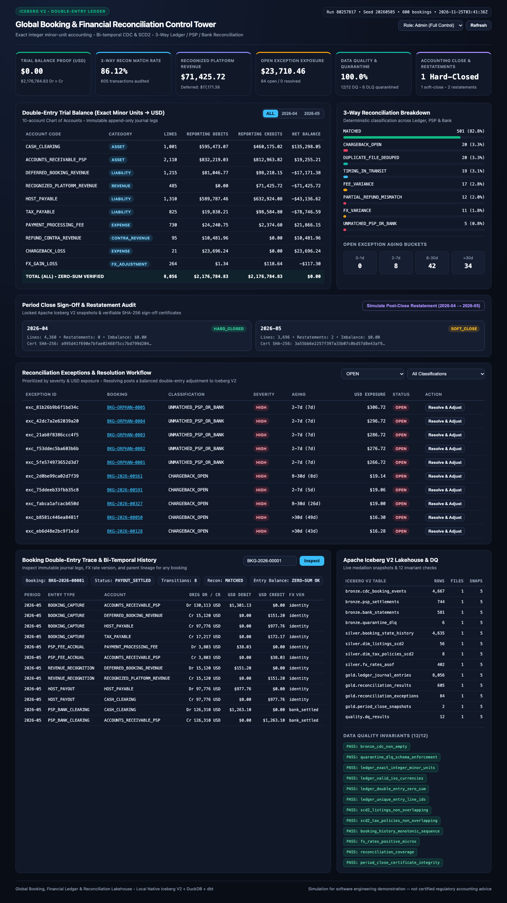

# Technical Appendix: Acceptance Matrix, Deep Verification & Ablations

This appendix consolidates the full 15-item acceptance matrix, detailed chaos drill evidence, dbt model/test breakdown, Data Quality inventory, compatibility resolution notes, and full Control Tower visual capture.

## Mandatory 15-Item Acceptance Matrix

| # | Acceptance Requirement | Status | Measured Verification Evidence |
|---|---|---|---|
| 1 | Fresh-clone setup starts core stack & verifies health | Pass (`local_native`) | `bash scripts/run_portable.sh` / `make setup && make pipeline && make serve`; `GET /health` returns HTTP 200 with `trial_balance_balanced: true` |
| 2 | Deterministic input generation produces same IDs & outcomes for same seed | Pass | `booking_ledger/simulator.py` + `deterministic_id()` (SHA-256); verified across `seed=20260505` and Hypothesis property suite |
| 3 | Real ingestion persists source data with metadata & replay capability | Pass | `LocalEventBroker` partitioned JSONL log with offsets, headers, consumer checkpoints, and `bronze.*` Apache Iceberg V2 snapshots |
| 4 | Core domain transformation yields correct results for known fixtures | Pass | `tests/unit/test_money_and_fx.py`, `test_temporal_and_scd2.py`, `test_double_entry_ledger.py`, `test_reconciliation_engine.py`, `test_close_and_restatement.py` |
| 5 | Domain-specific advanced features operational end-to-end with integration tests | Pass | Bi-temporal reconstruction, SCD2 non-overlap, double-entry ledger, as-of FX revisions, 3-way reconciliation, period close + restatements, and `dbt build` (35/35) |
| 6 | Duplicates, late events, and corrections follow documented semantics without corruption | Pass | `CHAOS-01` (2× CDC replay), `CHAOS-02` (reversed arrival stream), `CHAOS-03` (duplicate PSP file), `CHAOS-04` (late FX revision), `CHAOS-05` (post-close restatement) |
| 7 | Service crash/outage recovers according to tested guarantee | Pass | `CHAOS-06` broker outage & durable checkpoint resume with `zero_event_loss = true` |
| 8 | Backfill or replay produces reconcilable results with documented exceptions | Pass | Hypothesis `test_property_idempotent_replay_identical_trial_balance` + `CHAOS-01` prove bit-for-bit identical trial balances |
| 9 | Primary query/API/dashboard returns real computed outputs and freshness | Pass | Live FastAPI `:8040` + Control Tower UI showing `run_id`, `seed`, `completed_at`, `$0.00` imbalance, live exception resolution, and booking ledger traces |
| 10 | Data quality checks catch injected invalid inputs and retain auditable quarantine | Pass | `6` injected poison CDC events caught by FastAvro and archived in `bronze.quarantine_dlq`; `12/12` DQ invariants pass in `quality.dq_results` |
| 11 | Observability contains actual logs, metrics, and traces (or documented limits) | Pass | Structured PII-redacted JSON logs, `/metrics` Prometheus exposition, OpenTelemetry JSONL spans (`.local_data/traces/spans.jsonl`), OpenLineage events (`results/lineage/openlineage_sample.json`); live OTLP/Marquez push limitations disclosed in `docs/limitations.md` |
| 12 | Access control rejects unauthorized requests | Pass | `tests/e2e/test_finance_api_e2e.py` verifies `401` on missing/bad `X-API-Key` and `403` when `reader`/`auditor` attempt privileged writes |
| 13 | Controlled failure produces incident report with observed recovery behavior | Pass | `docs/incidents/INC-001-chaos-drill.md` backed by `results/chaos/chaos_results.json` |
| 14 | Benchmark records hardware, volume, commands, throughput/latency/RSS & raw outputs | Pass | `benchmarks/run_benchmarks.py` -> `results/benchmarks/benchmark_results.json`, `benchmark_profiles.csv`, and `docs/benchmarks/benchmark-report.md` |
| 15 | CI and tests execute with honest disclosure of unexecuted container profiles | Pass | `ruff` 0 errors, `mypy` 0 errors, `pytest` 22/22 passed (`results/tests/pytest_report.xml`), `.github/workflows/ci.yml`; distributed container execution boundary explicitly documented in `docs/limitations.md` |

## Detailed Chaos & Fault-Injection Results (`results/chaos/chaos_results.json`)

| Drill ID | Scenario | Result | Key Observed Evidence |
|---|---|---|---|
| `CHAOS-01` | Duplicate CDC replay (2× full stream) | PASS | `first_run_debits_usd_minor = 28,443,645` == `replayed_2x_debits_usd_minor = 28,443,645`, imbalance `0` |
| `CHAOS-02` | Out-of-order CDC (complete stream reversal) | PASS | `314` reversed events reconstructed identical `312`-row bi-temporal state history |
| `CHAOS-03` | Duplicate PSP settlement batch re-delivery | PASS | `75` duplicate lines removed across `144` raw lines; open exposure unchanged at `320,998` USD cents |
| `CHAOS-04` | Mid-month central bank FX revision (`v2_revised`) | PASS | Original `v1` captures unmutated; `2` balanced `FX_REVISION_ADJUSTMENT` legs posted to `FX_GAIN_LOSS` |
| `CHAOS-05` | Post-`HARD_CLOSED` late chargeback ($450.00) | PASS | Closed `2026-04` remained at `426` lines; `2` balanced restatement legs routed into `2026-05` |
| `CHAOS-06` | Broker outage mid-consumption | PASS | `BrokerUnavailableError` raised cleanly; resumed strictly from checkpoint (`5` pre + `5` post = `0` loss) |
| `CHAOS-07` | Schema-invalid poison CDC event (float money) | PASS | `4` poison events quarantined to `bronze.quarantine_dlq`; `233` valid events processed cleanly with `100%` DQ |

## Real `dbt build` Inventory (`results/dbt/dbt_build_summary.json`)

Executed with `dbt-core==1.11.17` and `dbt-duckdb==1.11.1` against DuckDB `2.0.0` (mirroring all 13 Apache Iceberg V2 tables):

- **4 Staging Views (`staging.*`):** `stg_booking_state_history`, `stg_ledger_journal_entries`, `stg_reconciliation_results`, `stg_fx_rates_asof`
- **4 Gold Financial Marts (`marts.*`):** `mart_trial_balance`, `mart_revenue_recognition`, `mart_reconciliation_bridge`, `mart_exception_aging`
- **27 Automated dbt Tests (25 schema + 2 singular financial assertions):** `unique`, `not_null`, `accepted_values` across all 8 reconciliation classifications, plus singular tests `assert_trial_balance_zero_sum` (per-period debit == credit) and `assert_no_orphan_journal_entries` (per-`journal_entry_id` original and reporting currency balance).
- **Result:** `PASS=35 WARN=0 ERROR=0 SKIP=0 TOTAL=35` in `~0.41s`.

## Data Quality Invariant Inventory (`results/dq/dq_report.json`)

All 12 automated assertions execute on every pipeline run and persist to Iceberg `quality.dq_results`:

1. `bronze_cdc_non_empty` (CRITICAL)
2. `quarantine_dlq_schema_enforcement` (HIGH)
3. `ledger_exact_integer_minor_units` (CRITICAL — verifies 0 IEEE-754 floats in all monetary columns)
4. `ledger_valid_iso_currencies` (CRITICAL)
5. `ledger_double_entry_zero_sum` (CRITICAL — verifies per-entry, per-currency, and global balance)
6. `ledger_unique_entry_line_ids` (CRITICAL)
7. `scd2_listings_non_overlapping` (CRITICAL)
8. `scd2_tax_policies_non_overlapping` (CRITICAL)
9. `booking_history_monotonic_sequence` (CRITICAL)
10. `fx_rates_positive_micros` (CRITICAL)
11. `reconciliation_coverage` (CRITICAL)
12. `period_close_certificate_integrity` (CRITICAL)

## Compatibility & Dependency Resolution Progression

During environment pinning on Python 3.12.8 / macOS ARM64, two real dependency conflicts were discovered and resolved cleanly (documented in ADR-06):

1. **`dbt-core==1.12.7` sdist network build:** `dbt-core==1.12.7` introduced `dbt-core-experimental-parser==2.0.11`, whose sdist wheel builder fetches from GitHub via Python `urllib` and fails macOS SSL certificate verification. Pinning `dbt-core==1.11.17` with `dbt-duckdb==1.11.1` eliminated the sdist build entirely while maintaining full `duckdb==2.0.0` compatibility.
2. **`mypy` vs `dbt-core` `pathspec` conflict:** `mypy==2.4.1` requires `pathspec>=1.0.0`, whereas `dbt-core==1.11.17` requires `pathspec>=0.9,<0.13`. Pinning `mypy==1.19.1` resolved `pathspec==0.12.1` cleanly so both `dbt` and `mypy` coexist in one unified `uv.lock`.

## Full Finance Control Tower Visual Capture

