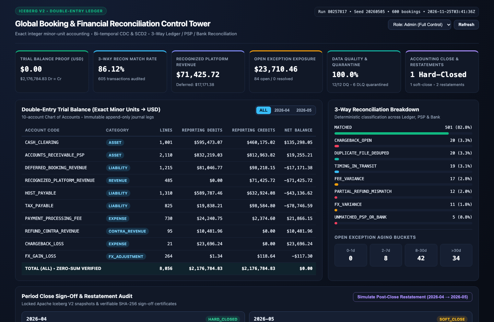
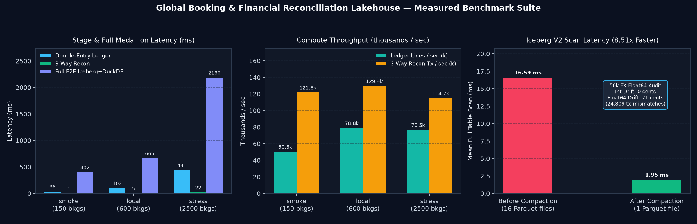

# Global Booking, Financial Ledger & Reconciliation Lakehouse

An open-source booking lifecycle, immutable double-entry accounting ledger, as-of FX conversion, 3-way settlement reconciliation, and period-close lakehouse built on **Apache Iceberg V2**, **DuckDB**, **dbt-core**, and **FastAPI**.

On an Apple M4 Pro workstation (14 logical cores, 48 GiB RAM, Python 3.12.8), the default 600-booking medallion batch (8,056 immutable journal legs across 6 currencies) completes durable broker ingestion, bi-temporal reconstruction, ledger posting, 3-way reconciliation, and Iceberg V2 + DuckDB persistence in **665.14 ms** with **$0.00 trial balance imbalance** (versus 24,809 per-transaction rounding mismatches and $0.71 silent drift in a 50,000-leg IEEE-754 `float64` comparison), **8.51× faster Iceberg table scans** after Parquet compaction, **35/35 `dbt build` models and tests passing**, **12/12 data quality checks passing**, **7/7 chaos drills passing**, and **22/22 pytest tests passing**.



## Architecture, Domain Engine & Runtime Stack

The platform models an Airbnb-style multi-currency hospitality marketplace with strict separation between at-least-once event transport and idempotent double-entry financial effects:

- **Transactional Outbox & Messy CDC Simulation (`booking_ledger/simulator.py`, `ingestion/cdc/`):** Deterministic seeded bookings across 6 markets (`USD`, `EUR`, `GBP`, `JPY`, `CAD`, `AUD`) and 6 host timezones (`America/New_York`, `Europe/Paris`, `Europe/London`, `Asia/Tokyo`, `America/Toronto`, `Australia/Sydney`), including holds, confirmations, modifications, payment retries, cancellations, partial refunds, host payouts, chargebacks, out-of-order CDC arrivals, duplicate deliveries, duplicate PSP settlement batches, late FX revisions, and schema-invalid poison records quarantined via FastAvro (`schemas/avro/` v1 and backward-compatible v2).
- **Exact Integer Minor-Unit Core (`booking_ledger/money.py`):** Every monetary value is stored as an exact integer in currency minor units (`BIGINT` / Python `int`, handling 0-decimal `JPY` alongside 2-decimal currencies) with FX rates scaled as exact integer micros (`1,000,000`). IEEE-754 `float` inputs are rejected on ledger paths.
- **Bi-Temporal State & SCD Type 2 Dimensions (`booking_ledger/temporal.py`):** Separates business time (`effective_at`) from system time (`recorded_at`) for point-in-time booking lookups and reproducible as-of FX resolution, while maintaining non-overlapping SCD Type 2 histories for `silver.dim_listings_scd2` and `silver.dim_tax_policies_scd2`.
- **Immutable Double-Entry Ledger & Period Close (`booking_ledger/ledger.py`, `close_engine.py`):** 10-account Chart of Accounts enforcing `SUM(debit) == SUM(credit)` per journal entry, per currency, per period, and globally. Modifications post linked reversing + adjusting entries; late FX revisions post reporting-only `FX_GAIN_LOSS` adjustments; `HARD_CLOSED` periods lock SHA-256 Sign-Off Certificates and route late post-close adjustments as restatements into the next open period.
- **3-Way Reconciliation Engine (`booking_ledger/reconciliation.py`):** Matches Internal Ledger, PSP Settlement Feeds, and Bank Statements deterministically into 8 statuses (`MATCHED`, `DUPLICATE_FILE_DEDUPED`, `TIMING_IN_TRANSIT`, `FEE_VARIANCE`, `FX_VARIANCE`, `PARTIAL_REFUND_MISMATCH`, `CHARGEBACK_OPEN`, `UNMATCHED_PSP_OR_BANK`) with aged exception tickets (`0-1d`, `2-7d`, `8-30d`, `>30d`) and live adjustment posting.
- **Apache Iceberg V2, DuckDB, dbt & Control Plane (`booking_ledger/iceberg_store.py`, `dbt_project/`, `services/finance_api/`):** Persists 13 Iceberg V2 tables (`bronze`, `silver`, `gold`, `quality`) with snapshot time travel and compaction, transforms analytical marts via real `dbt-core==1.11.17` + `dbt-duckdb==1.11.1` on `duckdb==2.0.0`, and serves an RBAC-protected FastAPI API + interactive Control Tower UI on `127.0.0.1:8040`.

### Runtime & Licensing Summary

| Component | Version / Mode | License | Notes |
|---|---|---|---|
| Core Python Platform | Python `3.12.8`, `pyiceberg==0.12.0`, `duckdb==2.0.0`, `pyarrow==25.0.1`, `dbt-core==1.11.17`, `dbt-duckdb==1.11.1`, `fastapi==0.163.2`, `fastavro==1.13.1` | Apache-2.0 / MIT / BSD / MPL-2.0 | Verified live in `local_native` mode; `results/security/license_audit.json` |
| Distributed Stack (`docker-compose.yml`) | PostgreSQL 17, Debezium `3.7.1.Final`, Kafka `4.3.2`, Apicurio `3.3.5`, RustFS `1.0.6`, Lakekeeper `v0.15.1`, Spark `4.1.4`, Trino `484`, Airflow `3.4.0`, Prometheus `v3.16.0`, Grafana `13.0.14`, Loki `3.6.22`, OTel `0.166.0`, Marquez `0.51.1` | Open-source (see `docs/compatibility.md`) | All container tags strictly pinned; statically validated (no local Docker daemon on build host) |
| Third-Party ML Weights | None (`0`) | N/A | 100% deterministic synthetic financial data; zero external weight downloads |

*Disclaimer: This repository is a software engineering reference implementation demonstrating financial data engineering invariants. It is not certified for regulatory GAAP/IFRS/SOX accounting.*

## Main Measured Results

All numbers below are 100% measured on Apple M4 Pro (14 logical cores, 48.0 GiB RAM, macOS `Darwin 24.6.0`, Python `3.12.8`) and backed by raw artifacts in `results/`.

### End-to-End Throughput & Latency (`results/benchmarks/benchmark_results.json`)

| Load Profile | Bookings | Ledger Lines | Ledger Stage (ms) | 3-Way Recon (ms) | Full E2E Iceberg + DuckDB (ms) | Ledger Throughput (lines/s) | Recon Throughput (tx/s) | Trial Balance Imbalance | Peak RSS (MiB) |
|---|---:|---:|---:|---:|---:|---:|---:|---:|---:|
| `smoke` | 150 | 1,909 | 37.96 | 1.25 | 402.04 | 50,284.1 | 121,774.6 | **0** | 198.94 |
| `local` | 600 | 8,054 | 102.25 | 4.68 | **665.14** | **78,766.6** | **129,395.6** | **0** | 260.50 |
| `stress` | 2,500 | 33,764 | 441.12 | 21.97 | 2,186.41 | 76,542.4 | 114,695.8 | **0** | 451.88 |

### Optimization & Numerical Integrity Comparisons

| Benchmark | Baseline | Optimized / Production Path | Measured Comparison |
|---|---|---|---|
| **Iceberg V2 Compaction** (`gold.ledger_journal_entries`, 8,223 rows) | 16 micro-batch Parquet files: `16.59 ms` mean scan | 1 compacted Parquet file: **`1.95 ms`** mean scan (`33.66 ms` rewrite) | **8.51× faster** full-table scan and **16.0× fewer** data files vs uncompacted Iceberg baseline |
| **Monetary Precision Audit** (`50,000` multi-currency FX legs) | Naive IEEE-754 `float64`: `24,809` per-tx mismatches, `$0.71` silent cumulative drift | Exact integer minor units + `Decimal` (`ROUND_HALF_EVEN`) | **0 mismatches** and **$0.00 drift** vs naive `float64` baseline |

### Verification Gate Summary

| Gate | Measured Result | Evidence Artifact |
|---|---|---|
| Live Local Batch (600 bookings) | `$2,176,784.83` Dr = Cr (**$0.00 imbalance**), `86.12%` clean 3-way match (`521/605`), `84` aged exceptions (`$23,710.46`), `6` poison events quarantined | `http://127.0.0.1:8040/v1/overview` |
| `dbt build` (DuckDB 2.0) | **35/35 passed** (4 staging views, 4 gold marts, 27 schema & singular zero-sum tests, 0 warnings) | `results/dbt/dbt_build_summary.json` |
| Data Quality Suite | **12/12 passed** (`100%`, gates `HARD_CLOSED` lock) | `results/dq/dq_report.json` |
| Automated Chaos Drills | **7/7 passed** (2× CDC replay, reversed out-of-order stream, duplicate PSP file, FX revision, post-close restatement, broker outage, poison DLQ) | `results/chaos/chaos_results.json` |
| Test Suite (`pytest`) | **22/22 passed** (unit, Hypothesis property, Avro v1/v2 contracts, Iceberg V2, dbt, E2E RBAC, chaos, performance) | `results/tests/pytest_report.xml` |
| Static, Lint, Typing & Security | `ruff` 0 errors, `mypy` 0 errors, static AST/YAML/JSON/tag-pinning PASS, SBOM (`102` components) | `results/security/{license_audit,sbom}.json` |



## How to Reproduce (Run on Any Machine)

### Option A: Zero-Docker Portable Runner (macOS / Linux with Python 3.12 + `uv`)

```bash
git clone https://github.com/rohanluniya/global-booking-reconciliation-lakehouse.git
cd global-booking-reconciliation-lakehouse
bash scripts/run_portable.sh
```

Then open **`http://127.0.0.1:8040/`** for the interactive Financial Close & Reconciliation Control Tower, or query the API:

```bash
curl -s http://127.0.0.1:8040/health
curl -s -H "X-API-Key: dev-finance-reader-key-change-me" http://127.0.0.1:8040/v1/ledger/trial-balance
```

### Option B: Step-by-Step Verification via `Makefile`

```bash
make setup       # uv sync --extra dev --python 3.12
make pipeline    # Medallion Iceberg V2 + DuckDB + dbt build (35/35) + DQ + OpenLineage
make chaos       # 7 automated chaos & fault-injection drills
make bench       # smoke / local / stress benchmarks + float64 drift audit + compaction
make plot        # Regenerate docs/assets/benchmark_finance_reconciliation.png
make test        # Full pytest suite (unit, Hypothesis, contracts, Iceberg, dbt, E2E, chaos)
make serve       # Launch FastAPI & Control Tower on http://127.0.0.1:8040
```

### Option C: Containerized & Distributed Profiles (Machines with Docker)

```bash
# Single-container standalone runtime on port 8040
docker compose -f docker-compose.standalone.yml up --build

# Multi-profile distributed stack (PostgreSQL + Debezium + Kafka + Lakekeeper + Spark + Trino + Observability)
cp .env.example .env
docker compose --profile core up -d
# Additional profiles: --profile analytics | --profile observability | --profile full
```

## Deep Documentation & Raw Evidence

- **[APPENDIX.md](APPENDIX.md)** — Full 15-item Acceptance Matrix, detailed chaos drill logs, 12-check DQ inventory, 35-node dbt breakdown, compatibility notes, and extended caveats.
- **`docs/architecture/`** — System/sequence diagrams and table contracts ([overview.md](docs/architecture/overview.md)), 7 ADRs ([ADRs.md](docs/architecture/ADRs.md)).
- **`docs/`** — [compatibility.md](docs/compatibility.md), [requirements.md](docs/requirements.md), [threat-model.md](docs/threat-model.md), [capacity-model.md](docs/capacity-model.md), [reliability.md](docs/reliability.md) (alert runbooks), [benchmarks/benchmark-report.md](docs/benchmarks/benchmark-report.md), [incidents/INC-001-chaos-drill.md](docs/incidents/INC-001-chaos-drill.md), [engineering-case-study.md](docs/engineering-case-study.md), [interview-deep-dive.md](docs/interview-deep-dive.md), [limitations.md](docs/limitations.md), [demo-script.md](docs/demo-script.md), [agent-handoff.md](docs/agent-handoff.md).
- **`results/`** — Raw committed JSON/CSV/XML outputs for benchmarks, chaos drills, dbt, DQ, OpenLineage, SBOM/licenses, and pytest.
