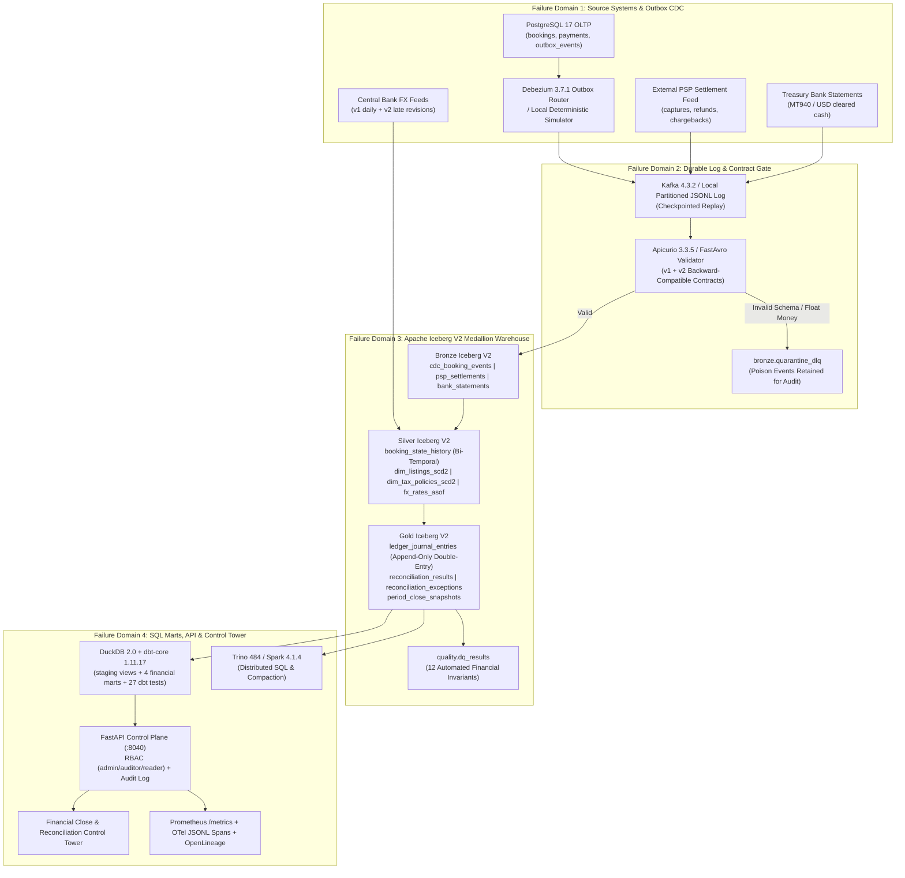

# System Architecture Overview

## End-to-End Component & Failure-Domain Diagram

The platform separates transactional booking capture, immutable double-entry accounting, 3-way settlement reconciliation, and period-close certification into clear medallion boundaries backed by Apache Iceberg V2 and DuckDB/dbt.



## Core Workflow Sequence (Booking Lifecycle -> Ledger -> 3-Way Recon -> Close)

```mermaid
sequenceDiagram
    autonumber
    participant OLTP as OLTP Outbox / Simulator
    participant Broker as Event Log + FastAvro Gate
    participant Silver as Bi-Temporal & SCD2 Engine
    participant Ledger as Double-Entry Ledger
    participant Recon as 3-Way Reconciliation
    participant Close as Period Close Controller
    participant Iceberg as Apache Iceberg V2 + DuckDB/dbt

    OLTP->>Broker: Emit booking CDC (out-of-order, duplicates, poison) + PSP + Bank
    Broker->>Broker: Validate Avro v1 contract; route poison rows to bronze.quarantine_dlq
    Broker->>Silver: Consume checkpointed offsets
    Silver->>Silver: Deduplicate by event_id, sort by (sequence_num, effective_at), build SCD2 & as-of FX
    Silver->>Ledger: Post balanced debit/credit legs (exact integer minor units)
    Ledger->>Ledger: Emit reversals on modifications & FX_GAIN_LOSS adjustments on late FX revisions
    Ledger->>Recon: Compare Internal Ledger vs deduped PSP Settlements vs Bank Statements
    Recon->>Recon: Classify into 8 deterministic statuses & open aged exception tickets
    Recon->>Close: Verify Trial Balance imbalance == 0 and DQ == 100%
    Close->>Iceberg: Commit locked HARD_CLOSED snapshot + SHA-256 Sign-Off Certificate
    Close-->>Ledger: Any late post-close event routes as Restatement into next OPEN period
    Iceberg->>Iceberg: Sync DuckDB analytical mirror & run dbt build (35 models + tests)
```

## Lakehouse Table Contracts (Grain, Keys, Temporal Semantics & Access Patterns)

| Table | Layer | Grain | Primary Key | Temporal Semantics | Primary Access Pattern |
|---|---|---|---|---|---|
| `bronze.cdc_booking_events` | Bronze | 1 raw valid CDC event | `event_id` (deduped downstream) | `effective_at` + `recorded_at` | Replay, audit, bronze-to-silver rebuild |
| `bronze.psp_settlements` | Bronze | 1 PSP file line | `settlement_id` + `file_batch_id` | `settled_at` | Duplicate batch detection, 3-way matching |
| `bronze.bank_statements` | Bronze | 1 bank settlement line | `statement_line_id` | `posted_at` | Cash clearing & FX variance matching |
| `bronze.quarantine_dlq` | Bronze | 1 rejected poison record | `dlq_id` | `quarantined_at` | Schema-break triage & incident replay |
| `silver.booking_state_history` | Silver | 1 booking transition | `state_id` | Bi-temporal (`effective_at`, `recorded_at`, `valid_from`, `valid_to`) | Point-in-time booking state reconstruction |
| `silver.dim_listings_scd2` | Silver | 1 listing rate/fee version | `surrogate_key` | SCD Type 2 `[valid_from, valid_to)` | Historical rate & host-fee lookups |
| `silver.dim_tax_policies_scd2` | Silver | 1 jurisdiction tax version | `surrogate_key` | SCD Type 2 `[valid_from, valid_to)` | Tax rate audit at booking date |
| `silver.fx_rates_asof` | Silver | 1 currency-date-version rate | `fx_id` | Bi-temporal (`effective_date`, `recorded_at`) | Reproducible as-of FX conversion & revaluation |
| `gold.ledger_journal_entries` | Gold | 1 double-entry leg | `entry_line_id` | Append-only immutable + `parent_entry_id` | Trial balance, booking ledger trace, revenue rec |
| `gold.reconciliation_results` | Gold | 1 booking/orphan 3-way check | `recon_id` | `reconciled_at` | Payout bridge, match rate KPIs |
| `gold.reconciliation_exceptions` | Gold | 1 unresolved/resolved ticket | `exception_id` | `detected_at`, `resolved_at`, `age_days` | Exception triage, aging, resolution adjustments |
| `gold.period_close_snapshots` | Gold | 1 accounting period lock | `snapshot_id` | `closed_at` + SHA-256 digest | Month-end close sign-off & immutability proof |
| `quality.dq_results` | Quality | 1 DQ assertion per run | `run_id` + `check_name` | `checked_at` | Close gate verification & observability |

## Consistency & Replay Semantics

- **Delivery vs Business Effect:** Ingestion provides **at-least-once** delivery from the durable topic log (`LocalEventBroker` or Kafka 4.3.2). Downstream business effects are **idempotent** via deterministic SHA-256 IDs (`event_id`, `journal_entry_id`, `entry_line_id`, `recon_id`). Replaying the broker from offset 0 produces a bit-for-bit identical trial balance.
- **Immutability Boundary:** Prior journal entries and `HARD_CLOSED` period snapshots are never mutated or deleted. Modifications emit reversing + adjusting entries; late post-close events emit `is_restatement = true` entries in the next open period.
