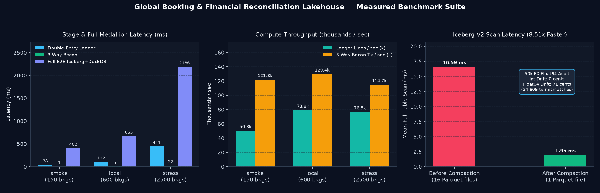

# Benchmark Report

All results in this report are 100% measured outputs recorded in `results/benchmarks/benchmark_results.json` and `results/benchmarks/benchmark_profiles.csv`, generated by `uv run python benchmarks/run_benchmarks.py`.

## Hardware & Software Environment

- **Host:** macOS `Darwin 24.6.0` (`arm64`, Apple M4 Pro, 14 logical CPU cores, 48.0 GiB RAM)
- **Runtime:** Python `3.12.8`, `pyiceberg==0.12.0`, `pyarrow==25.0.1`, `duckdb==2.0.0`, `dbt-core==1.11.17`, `dbt-duckdb==1.11.1`, `fastavro==1.13.1`
- **Reproduce Command:** `uv run python benchmarks/run_benchmarks.py && uv run python benchmarks/plot_benchmarks.py`

## Load Profile Progression (`smoke`, `local`, `stress`)

| Profile | Bookings | Raw CDC Events | Ledger Lines | Temporal (ms) | Double-Entry Ledger (ms) | 3-Way Recon (ms) | Period Close (ms) | Full E2E Iceberg+DuckDB (ms) | Ledger Throughput (lines/s) | Recon Throughput (tx/s) | Trial Balance Imbalance | Peak RSS (MiB) |
|---|---:|---:|---:|---:|---:|---:|---:|---:|---:|---:|---:|---:|
| `smoke` | 150 | 1,175 | 1,909 | 6.67 | 37.96 | 1.25 | 0.32 | 402.04 | 50,284.1 | 121,774.6 | 0 | 198.94 |
| `local` | 600 | 4,673 | 8,054 | 22.93 | 102.25 | 4.68 | 1.24 | 665.14 | 78,766.6 | 129,395.6 | 0 | 260.50 |
| `stress` | 2,500 | 19,566 | 33,764 | 97.60 | 441.12 | 21.97 | 5.63 | 2,186.41 | 76,542.4 | 114,695.8 | 0 | 451.88 |

Key observations:
- End-to-end medallion persistence scales sub-linearly per booking from `smoke` to `stress` (`4,748` -> `15,443` E2E ledger lines/sec) as fixed Iceberg catalog initialization overhead is amortized over larger batches.
- Domain accounting throughput remains steady at **76,542 ledger lines/sec** and **114,696 3-way reconciliation checks/sec** under the 2,500-booking stress profile, with **0 minor-unit imbalance** across every profile.

## Exact Integer Minor Units vs Naive IEEE-754 Float64 Audit

Evaluated across `50,000` randomized multi-currency FX conversions (`EUR`, `GBP`, `JPY`, `CAD`, `AUD` -> `USD`):

| Representation | Exact Sum (USD Cents) | Per-Tx Rounding Mismatches | Cumulative Silent Drift |
|---|---:|---:|---:|
| **Exact `int` Minor Units + `Decimal` (`ROUND_HALF_EVEN`)** | `5,716,812,989` | **0** | **0 cents ($0.00)** |
| Naive IEEE-754 `float64` Conversion | `5,716,813,060` | 24,809 | 71 cents ($0.71) |

## Apache Iceberg V2 Compaction Before/After Benchmark

Target table: `gold.ledger_journal_entries` (`8,223` rows written across 16 incremental micro-batch appends, then compacted via `IcebergLakehouseStore.compact_table()`):

| State | Parquet Data Files | Mean Full Table Scan (5 runs) | Improvement vs Fragmented Baseline | Compaction Duration |
|---|---:|---:|---:|---:|
| Before Compaction (16 streaming appends) | 16 | 16.59 ms | baseline | — |
| **After Compaction (1 rewritten file)** | **1** | **1.95 ms** | **8.51× faster full scan, 16.0× fewer files** | 33.66 ms |

